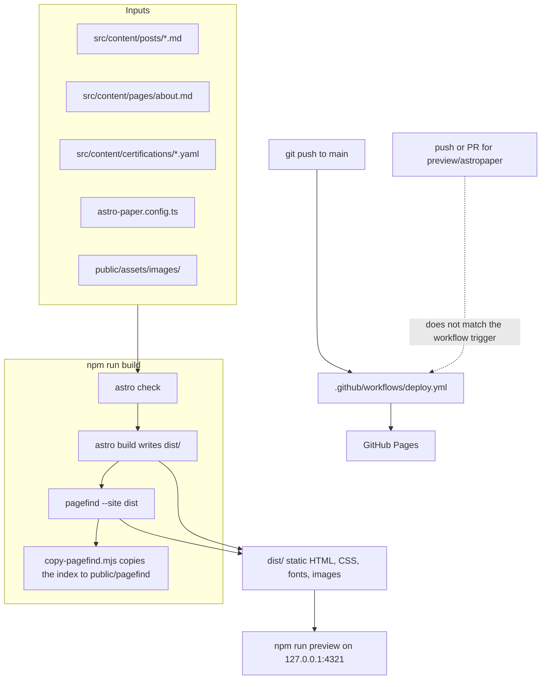

# FORJAMES

Audience: Jamie. You know Nutanix, Citrix, Azure, and PowerShell. This file is the map for the Astro preview on branch `preview/astropaper`. It uses only what is in this branch and what was run here. Anything not run is marked untested.

## 1. What this is

This branch is a throwaway rebuild of Nutanix Vibes on the AstroPaper theme. It is not the live site.

The live site is still the Casper theme on `main`. Publishing is `.github/workflows/deploy.yml`. That file was not edited. Its hash on this branch matches `main`. `public/CNAME` still contains `nutanixvibes.com` and was not edited.

AstroPaper is the MIT-licensed theme at https://github.com/satnaing/astro-paper. The license text is `LICENSE` (Copyright (c) 2023 Sat Naing).

Think of this branch as a golden image you built in a lab VLAN. It is bootable. It is not in the production cluster, and the runbook that promotes images (`deploy.yml`) still only watches `main`.

## 2. Architecture

Astro is a static site generator. At build time it reads markdown, YAML, and templates and writes plain HTML into `dist/`. After the build, nothing in this preview calls GitHub, Algolia, or any other API. Hosting the result is the same idea as publishing a file share: the web server only has to hand out files.



`public/pagefind/` is gitignored (`.gitignore`). It exists so a later `astro dev` can serve an index you already built. `astro preview` serves `dist/`, which already contains the index.

The certification YAML is not its own page. `src/pages/about.astro` renders it at `/about#certifications`. `src/pages/certifications.astro` is a meta refresh to that anchor.

## 3. Codebase map

| Path | What it is |
| --- | --- |
| `docs/LAUNCH-CHECKLIST.md` | One-time pre-launch list for the nutanixvibes.com cutover. Not a site page. |
| `astro-paper.config.ts` | Site name, URL, author, timezone, social links, Pagefind on, edit-post link off. This is the file you edit for site settings. |
| `astro.config.ts` | Astro itself: Markdown plugins, sitemap, Tailwind, Google Sans Code, JetBrains Mono. |
| `src/config.ts` | Applies defaults on top of `astro-paper.config.ts`. Do not put content here. |
| `src/content.config.ts` | Schema for posts, pages, and the certifications collection. Same role as a validated object schema in a Desired State config. |
| `src/content/posts/` | The two migrated posts. |
| `src/content/pages/about.md` | About page prose. Same text as the old `src/data/about.md` on `main`. |
| `src/pages/about.astro` | Renders that prose, then the certifications section at `#certifications`. |
| `src/content/certifications/` | Curated Nutanix and Citrix credentials from Jamie's LinkedIn, read 1 Nov 2026. No expiry dates. |
| `src/pages/certifications.astro` | Static redirect to `/about#certifications`. Not a content page. |
| `src/pages/[...slug]/` | One post page per file in `src/content/posts/`, served at `/{slug}/`. |
| `src/pages/` | Other routes. A file here becomes a URL. `src/pages/quest.astro` is `/quest`. The posts list stays at `/posts/`. |
| `src/components/Header.astro` | Nav. Start here and GitHub stats are in this list. Certifications and Quest are not. |
| `src/components/Card.astro` | Post card on the home page, the posts list, and Start here. |
| `src/components/PostMeta.astro` | Level and topic badges, plus the "Before you start" block on a post. |
| `src/layouts/Layout.astro` | HTML shell, fonts, and the script that sets dark mode before the first paint. |
| `src/styles/theme.css` | Colors. Dark is the default on `:root`. Light is `[data-theme="light"]`. Hex values are cited in section 5. |
| `src/styles/global.css` | Grid background and the scanline overlay. |
| `src/pages/search.astro` | Pagefind UI. No Algolia. |
| `public/assets/images/` | Cover images kept from the Casper site. |
| `public/og.jpg` | Copy of `public/assets/images/about-hero.jpg`. The theme only accepts a single filename in `public/` for the site OG image (`src/utils/resolveDefaultOgImagePath.ts`). |
| `public/CNAME` | Untouched. Still `nutanixvibes.com`. |
| `.github/workflows/deploy.yml` | Untouched. See section 5. |
| `scripts/import-wordpress.py` | Still the old importer. It writes `pubDate` and `categories` into `src/content/blog/`, which this theme does not use. Not run on this branch. |
| `package.json` | Scripts, Node engine, and one npm override. See section 7. |
| `.nvmrc` | `22.23.4`. |

Old Casper files are gone on this branch, including `src/components/AlgoliaSearch.astro`, `src/pages/[slug].astro`, and `src/content/authors/jamie.json`.

## 4. Tech stack and why

| Piece | Version in this build | Why it is here |
| --- | --- | --- |
| Node.js | `22.23.4` was the version used. `package.json` `engines` says `>=22.23.4`. `.nvmrc` says `22.23.4`. | Same floor as upstream AstroPaper. The previous site allowed `>=22.12.0`. |
| Astro | `package.json` asks for `^7.4.2`. The install resolved `7.4.4` (`astro v7.4.4` in the build log). | AstroPaper 7.0.0 already targets Astro 7. The Casper site on `main` is Astro `^6.4.7`. |
| Tailwind CSS 4 | `@tailwindcss/vite` `^4.3.3` | What the theme uses for layout. Tokens live in `src/styles/theme.css`. |
| Pagefind | `pagefind` `^1.5.2`. The build log printed Pagefind v1.6.0. | Local search index, produced during `npm run build`. No hosted search account. |
| TypeScript | `^6.0.3`, strict config in `tsconfig.json` | `astro check` typechecks the templates before the HTML is written. |
| ESLint and Prettier | `npm run lint`, `npm run format:check` | The checks the theme ships. Both passed on this branch. |

Fonts: Google Sans Code is the body font (the theme default). JetBrains Mono is the accent font for the site title, nav, headings, and badges (`--font-accent` in `src/styles/theme.css`, loaded in `src/layouts/Layout.astro`). The build log copied 28 font files. Those files are downloaded at build time by Astro's Google font provider. An offline build was not tested.

There is no app server, no database, and no client-side content API.

## 5. Decisions log

### AstroPaper instead of Casper

`main` is the Casper theme (commit `fd3ba09`, "Migrate to Casper Astro theme"). Casper stored Ghost-style fields the new schema does not want: `class`, `subclass`, `current`, `navigation`, `disqus`. Its post URLs were `src/pages/[slug].astro`, so a post lived at `/{slug}`.

AstroPaper already has the fields the migration asked for (`pubDatetime`, `ogImage`), a light/dark toggle, and Pagefind wired in `src/pages/search.astro`. Rebuilding on it meant deleting the Casper components and keeping the two posts, the about prose, and the images. It was not a patch on top of Casper.

### Pagefind instead of Algolia

On `main`, `src/components/AlgoliaSearch.astro` loaded Algolia from a CDN when `SITE_CONFIG.algolia` was set. `src/config.ts` on `main` had no `algolia` block and no keys. No `.env` file is in the repo. Tracked source on this branch has no Algolia strings. GitHub Actions secrets were not inspected.

`astro-paper.config.ts` sets `features.search` to `"pagefind"`. `npm run build` runs `pagefind --site dist`. Only posts carry `data-pagefind-body` (`src/pages/[...slug]/index.astro`), so the placeholder pages are not in the index. A search for `prism` on the preview returned both posts at `/{slug}/`. That was checked in the browser.

### Astro 7

The Casper `package.json` on `main` depends on `astro` `^6.4.7`. This branch uses the current AstroPaper package set, which is Astro 7. The resolved version in this environment is 7.4.4. Node was raised to `>=22.23.4` because that is the engine AstroPaper declares. The machine that built this branch was already on v22.23.4.

### Nutanix colors

The first preview used a terminal green I picked (`#3ddc97` / `#085232`). That is gone.

The July 2026 partner PDF at `https://www.nutanix.com/content/dam/nutanix/en/cmn/documents/nutanix-brandbook.pdf` says the logo is only Charcoal Gray or white, and that a wider brand palette exists. The PDF text does not include hex values. I did not add a logo or a wordmark.

The hex values are from the stylesheet the nutanix.com homepage linked on 1 Nov 2026:

`https://static-p136464-e1403605.adobeaemcloud.com/ba0aa07b7a03dea49fca8f8f6ae1149fc70abfa9379acb892e5d78b51491651f/clientlib-site/theme.css`

That file's `:root` block is the source. `src/styles/theme.css` names the same custom properties.

| UI token | Hex | Nutanix.com CSS | Contrast I calculated |
| --- | --- | --- | --- |
| Light background | `#ffffff` | `--btn-neutral-background-dark` | Body `#131313` on this is 18.58:1 |
| Light text | `#131313` | `--black` | 18.58:1 on `#ffffff`, 17.19:1 on `#f6f6f6` |
| Light accent | `#7855fa` | `--btn-brand-background`, `--btn-brand-text-link` | 4.69:1 on `#ffffff` |
| Light text on accent | `#ffffff` | `--btn-brand-text` | 4.69:1 on `#7855fa` |
| Light muted surface | `#f6f6f6` | `background:#f6f6f6` in that stylesheet | Body text on it is 17.19:1 |
| Light secondary text | `#595959` | `--secondary-text` | 7.00:1 on `#ffffff`, 6.48:1 on `#f6f6f6` |
| Light border | `#c7c7c7` | `--btn-neutral-background-dark-pressed` | Border, not body text |
| Dark background | `#131313` | `--black`, `--btn-neutral-background` | Body `#ffffff` on this is 18.58:1 |
| Dark text | `#ffffff` | `--btn-neutral-text`, `--btn-brand-text` | 18.58:1 on `#131313` |
| Dark accent | `#a188fc` | `--btn-brand-text-dark-link`, `--btn-brand-text-dark-outlined` | 6.59:1 on `#131313` |
| Dark text on accent | `#131313` | `--black` | 6.59:1 on `#a188fc`. White on `#a188fc` is 2.82:1, so it is not used. |
| Dark muted surface | `#2a2a2a` | `--btn-neutral-background-hover` | Body text on it is 14.35:1 |
| Dark secondary text | `#c7c7c7` | `--btn-neutral-background-dark-pressed` | 10.99:1 on `#131313` |
| Dark border | `#474747` | `--btn-neutral-background-pressed` | Border, not body text |

`#7855fa` on `#131313` is 3.96:1, under AA for normal text, so dark mode uses the dark-link purple instead. `#595959` on `#131313` is 2.65:1, so dark secondary text does not use `--secondary-text`. No automated axe scan was run. These ratios are from a local WCAG calculation, not from Nutanix.

### Posts stay on the Casper URLs

I built `main` at commit `6c3e966` and listed every HTML and XML file under `dist/`. The two posts were already at:

- `/nutanix-7-5-just-dropped-heres-what-actually-matters/`
- `/prism-central-tip-use-the-view-by-dropdown-for-faster-vm-audits/`

Those paths are the post pages again. `getPostUrl` in `src/utils/getPostPaths.ts` no longer prefixes `posts/`. Cards, the RSS items in `src/pages/rss.xml.ts`, canonical and `og:url`, and Pagefind all use that helper or the built file path. A search for `prism` returned `/prism-central-tip-use-the-view-by-dropdown-for-faster-vm-audits/` and `/nutanix-7-5-just-dropped-heres-what-actually-matters/`. There is no `/posts/{slug}/` page. Preview returned HTTP 404 for that shape and HTTP 200 for both original post URLs.

The new top-level pages are `about`, `archives`, `certifications`, `github-stats`, `posts`, `quest`, `search`, `start-here`, and `tags`. None of those names is a current post slug. `assertPostRouteAvailable` throws at build time if a future post file would take one of those paths.

`main` did not publish a page 2. Page size was 10 and there are 2 posts, so there is no `/2/`, `/tag/{tag}/page2/`, or `/author/jamie/page2/` to redirect.

These Casper URLs did exist and no longer have their own content. `astro.config.ts` `redirects` writes a static HTML page for each one: meta refresh, `noindex`, and a canonical link to the new URL. Tag and author feeds go to `/rss.xml` because this theme has one feed, not a feed per tag or author.

| Old URL from the `main` build | New URL |
| --- | --- |
| `/feed.xml` | `/rss.xml` |
| `/author/jamie/` | `/about/` |
| `/author/jamie/feed.xml` | `/rss.xml` |
| `/tag/ahv/` | `/tags/ahv/` |
| `/tag/ahv/feed.xml` | `/rss.xml` |
| `/tag/cvm/` | `/tags/cvm/` |
| `/tag/cvm/feed.xml` | `/rss.xml` |
| `/tag/ngt/` | `/tags/ngt/` |
| `/tag/ngt/feed.xml` | `/rss.xml` |
| `/tag/nutanix/` | `/tags/nutanix/` |
| `/tag/nutanix/feed.xml` | `/rss.xml` |
| `/tag/prism-central/` | `/tags/prism-central/` |
| `/tag/prism-central/feed.xml` | `/rss.xml` |
| `/tag/tips/` | `/tags/tips/` |
| `/tag/tips/feed.xml` | `/rss.xml` |

`/`, `/about/`, and `/404` exist on both builds, so they are not redirects. The sitemap filter drops the legacy paths and `/certifications`.

Preview on `127.0.0.1:4321` returned HTTP 200 for `/feed.xml` (refresh to `/rss.xml`), `/author/jamie/` (refresh to `/about/`), `/tag/ahv/` (refresh to `/tags/ahv/`), and `/rss.xml` (the RSS document). `dist/CNAME` is `nutanixvibes.com`, copied from `public/CNAME`.

### Launch checklist

`docs/LAUNCH-CHECKLIST.md` is a one-time list for the relaunch. It is not routed from `src/pages/`, so `npm run build` does not publish it. It adapts the pre-launch site checks and the owned, rented, and borrowed channel split from Corey Haines's launch skill (`coreyhaines31/marketingskills`, MIT, copyright 2025). The file credits that skill. It does not include the skill's Product Hunt steps or its affiliate link. The checks name this repo's files: `public/CNAME`, the two `/{slug}/` posts, `/rss.xml`, Pagefind, dark and light, the curated cards in `src/content/certifications/`, and the `/github-stats` placeholder. The channel list is the LinkedIn and X URLs in `astro-paper.config.ts`, the Nutanix community Jamie already uses, and the GitHub profile README for `nutanixguy`, which is a different repo. No traffic or follower numbers are stated, because this repo has none.

### Quest id stays in the data and off the post

`quest_id` is still an optional field in `src/content.config.ts`, and both posts still set it. `src/components/PostMeta.astro` no longer prints that value or a link to `/quest`. A post whose only extra field is `quest_id` does not get a Before you start box. Estimated time, updated date, prerequisites, and objectives still render. The heading visitors see is "Before you start", and its id is `before-you-start-heading`. `/quest` still lists the ids that are already on the posts. That page was not changed.

### Certifications live on About

The standalone certifications page is gone from the nav. `src/pages/about.astro` renders `src/content/certifications/` at `/about#certifications`, newest first. The nine entries are the curated set from Jamie's LinkedIn profile, read 1 Nov 2026: the Nutanix 7 Business Continuity and Network & Security credentials, NCP-MCI 6 (Credly `8b2e7d71`), NCA 6 (Credly `02deabff`), one combined Nutanix Technology Champion 2023-2026 entry linked to the 2026 badge, NCM 5, NCP End User Computing, Citrix CC-VAD-CC, and CCE-V with no date and no link. Expiry dates are not stored or shown. A "Full list on LinkedIn" link points at `https://www.linkedin.com/in/jamieterrell/`. `src/pages/certifications.astro` is still a noindex meta refresh to that anchor. The sitemap filter in `astro.config.ts` drops `/certifications`.

### Other choices

- Dark is the default. `src/layouts/Layout.astro` puts `data-theme="dark"` on `<html>`. The boot script stays on dark unless `localStorage` is exactly `"light"` or `"dark"`. `src/scripts/theme.ts` uses the same rule when nothing is stored. A later operating-system theme change still overwrites that choice. That listener was not exercised.
- The header is `max-w-6xl` so the extra nav links fit. Article text stays `max-w-3xl` (`src/styles/global.css`).
- The posts list is `/posts/`. Individual posts are not under that prefix. See the decision below.
- `updated` on both posts equals `pubDatetime`. The Casper files had one `date` and no revision date. Both timestamps are `12:00:00.000Z` so the calendar day stays 30 Jan 2026 and 16 Feb 2026 in `America/New_York`.
- `est_minutes` is 5 for the 7.5 post and 8 for the View by post. `wc -w` on the markdown bodies was 530 and 356 words. Five minutes is a read of the briefing. Eight minutes allows clicking through the Prism views the second post describes. These are estimates, not measured lab times.
- Level `beginner` on the View by post: it is a Prism Central UI tip. Level `intermediate` on the 7.5 post: it assumes CVM, CCLM, NGT, and protection policies.
- Timezone `America/New_York` is an assumption. The about page says "Based in Georgia." The removed author file on `main` (`src/content/authors/jamie.json`) said "Georgia, USA". If that Georgia is the country, this timezone is wrong.
- `features.editPost.enabled` is false. The theme default pointed at `github.com/satnaing/astro-paper`.
- The About certification cards are the curated LinkedIn set in `src/content/certifications/`. Older and expired credentials from that same LinkedIn read are not in the YAML. The About prose still mentions a broader set in passing.
- `/quest` is a coming-soon page and is not in the nav. Start here and GitHub stats are.
- `package.json` overrides `@astrojs/markdown-satteri` to `0.4.6`. See section 7.
- AstroPaper's own `.github/workflows/ci.yml` uses pnpm and runs on pull requests. It was not copied. The template has no deploy workflow, so there was nothing to delete. This branch's only workflow is the original `deploy.yml`.

### Field mapping for the two posts

| Casper field | AstroPaper field |
| --- | --- |
| `date` | `pubDatetime` |
| `cover` | `ogImage` (root-relative path under `/assets/images/`) |
| `class`, `subclass`, `current`, `navigation`, `disqus` | removed |
| body and cover files | kept |

New optional fields, all set on both posts: `level`, `topic`, `prerequisites`, `objectives`, `est_minutes`, `quest_id`, `updated`.

## 6. How to run and test

From the repo root, on Node 22.23.4 or newer:

```bash
npm ci
npm run dev
```

`npm run dev` serves http://localhost:4321/. Search can be empty until you have run `npm run build` once, because Pagefind reads `dist/`. The dev warning in `src/pages/search.astro` says `npm run build`.

Checks the theme expects:

```bash
npm run lint
npm run format:check
npm run build
npm run preview -- --host 127.0.0.1 --port 4321
```

`npm run build` is three steps: `astro check`, `astro build`, then Pagefind. Output is `dist/`.

Do not push this branch to `main`. A push to `main` runs `deploy.yml`, which runs `npm run build` and uploads `dist/` to GitHub Pages.

### Smoke test

Run on this branch in this environment, after `npm ci`:

1. `node -v` printed `v22.23.4`.
2. `npm ci` completed (578 packages) after the override in section 7.
3. `npm run format:check` passed.
4. `npm run lint` passed (exit 0, no findings).
5. After the Nutanix color change, `npm run lint` passed, `npm run format:check` passed, and `npm run build` passed. `astro check` reported 0 errors, 0 warnings, 0 hints. Astro 7.4.4 wrote 19 pages. Pagefind indexed 2 pages and 505 words. `/certifications` is one of those 19 pages, and it is only the redirect.
6. `npm run preview` came up at http://127.0.0.1:4321/.
7. A headless Chrome pass at viewport width 1280 opened these URLs. Each returned HTTP 200, set `data-theme` to the requested mode, and threw no page errors:
   - `/`
   - `/prism-central-tip-use-the-view-by-dropdown-for-faster-vm-audits/`
   - `/about/` (the certifications section was in the document)
   - `/search/`
8. On `/search/`, the Pagefind box accepted `prism` and showed 2 results.
9. `/certifications/` followed its meta refresh to `/about#certifications`.
10. Full-page screenshots for this pass, dark and light, are `screenshot_brand_home_*.png`, `screenshot_brand_post_*.png`, `screenshot_brand_about_*.png`, and `screenshot_brand_search_*.png` under `/opt/cursor/artifacts/`.

Not part of that smoke test: keyboard-only navigation, a screen reader, a phone viewport, `npm run dev` (preview was the production build), the WordPress importer, and a real GitHub Pages deploy.

## 7. Lessons learned

`npm install` and `npm ci` did not agree until the lockfile was pinned. `@astrojs/mdx@7.0.8` has an optional peer on `@astrojs/markdown-satteri@^0.3.1`. That range does not include 0.4.x. Astro 7.4.4 depends on `@astrojs/markdown-satteri@0.4.6`. npm 10.9.9's `npm ci` tried to place 0.3.8 next to 0.4.6 and rejected the lock. `npm install` had accepted it. The override in `package.json` forces 0.4.6. After that, `npm ci` succeeded. pnpm, which upstream AstroPaper uses, did not have this problem. This repo uses npm because the task asked for `npm ci`.

Astro's `image()` schema treated `/assets/images/...` as an imported file and failed the build with `ImageNotFound`. Those files live in `public/`, which is copied as-is and is not an import. `src/content.config.ts` accepts a root-relative string first, and only then tries `image()` for a relative path under `src/`.

Pagefind's default UI only indexes HTML marked `data-pagefind-body`. That is why search returns the two posts and not Start here or the placeholders. That surprised me until the build log said "Ignoring pages without this tag."

The deploy workflow is safe for this branch only because its `on.push.branches` list is `[main]` and it also allows `workflow_dispatch`. A branch name does not protect you if someone later adds `pull_request` or `**` to that trigger. Read the file before the next push.

I compared `.github/workflows/deploy.yml` with this branch and did not edit it. `actions/setup-node@v4` with `node-version: 22` installs the newest Node 22 in the `actions/node-versions` manifest. On 2 Nov 2026 that newest release is `22.23.4`, the same value as `.nvmrc`. It satisfies `package.json` `engines.node` (`>=22.23.4`) and the installed `astro` package engines (`node >=22.23.4`, `npm >=9.6.5`). Node 22.23.4 includes npm 10.9.9. The workflow runs `npm ci` and then `npm run build`, which is the script in `package.json`: `astro check && astro build && pagefind --site dist && node copy-pagefind.mjs`. The upload path is `dist`. That is the same package manager, the same build command, and a Node version this branch accepts. `SITE_URL` is set in the workflow and is not read. The site URL comes from `astro-paper.config.ts` and is already `https://nutanixvibes.com`. No change to `deploy.yml` is required for this branch to build. I did not run the GitHub Actions workflow itself.

## 8. Open questions and known gaps

- Merging this branch would change production. `deploy.yml` on `main` would build this tree and deploy it. That deploy was not run. This PR is a draft and should not be merged.
- Post URLs match `main` again (`/{slug}/`). The Casper tag, author, and feed URLs redirect as listed in section 5. A GitHub Pages deploy of this branch was not run, so the directory-style redirect pages (`feed.xml/index.html` and the rest) were checked with `astro preview`, not on Pages itself.
- `America/New_York` may be wrong if "Georgia" in the about page is not the US state.
- `updated` duplicates the publish timestamp. There is no evidence the posts were revised later.
- `est_minutes`, `level`, `quest_id`, prerequisites, and objectives were filled in for the preview. They are not from the original frontmatter.
- `/github-stats` does not fetch anything. A future build step could read public GitHub data for `nutanixguy` while `npm run build` runs. That step is not designed here, and no token should be added for it.
- The certifications YAML is fiction. It renders on `/about#certifications`. `/certifications` only redirects there. It is not a credential inventory.
- `/quest` does not run a quest. The ids `aos-7-5-briefing` and `pc-view-by` are labels on the posts.
- `scripts/import-wordpress.py` still targets `src/content/blog` and writes `pubDate` plus `categories`. Running it would not produce valid AstroPaper posts. Not run.
- Search does not include the new pages. Add `data-pagefind-body` on those pages if they should be searchable.
- The theme's OS theme-change listener can leave dark mode. Not tested.
- No axe scan, no screen reader, no mobile viewport check. Desktop 1280 dark and light were screenshotted.
- `features.dynamicOgImage` is still on. Posts that set `ogImage` skip the generated PNG (`src/pages/[...slug]/index.png.ts`). `/og.png` is still generated for the site fallback. A post with no `ogImage` was not tested.
- Font download needs network at build time. An offline build was not tested.
- Upstream AstroPaper CI (pnpm, Node 24) was not added. This branch has no PR lint workflow of its own. Lint was run locally.
