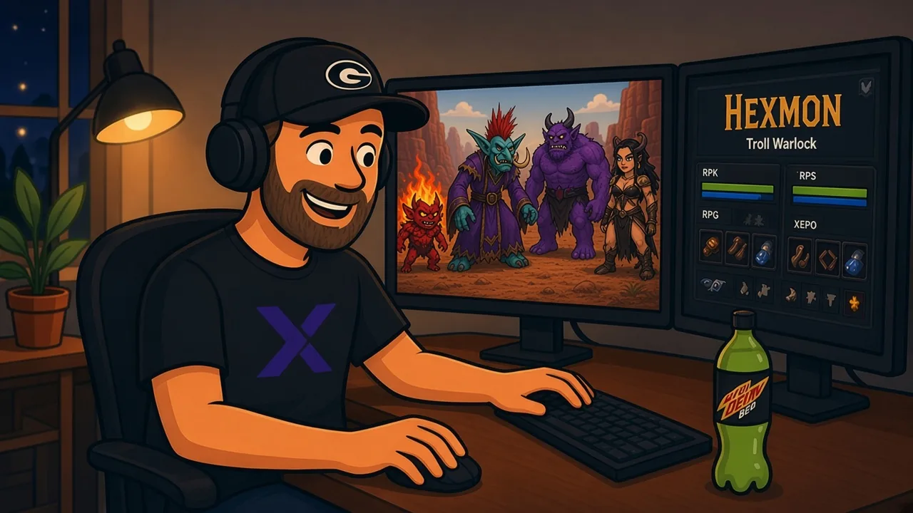
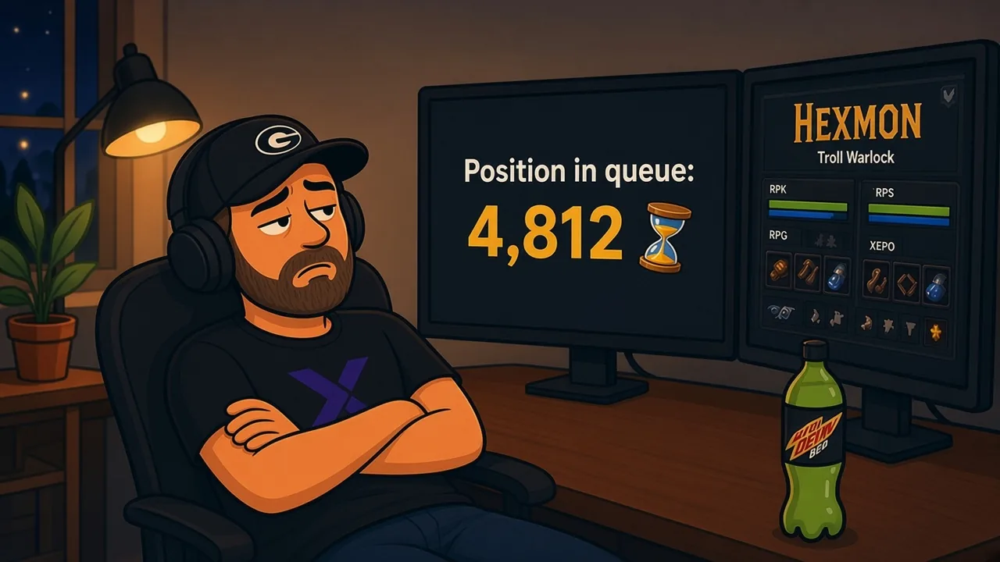

No clusters this week. No licensing tables. Just a sound every old WoW player knows: the login music. I first heard it back in 2004, when the game launched, and I hadn't heard it in years. Then WoW: Forever showed up, and suddenly it's me, a Troll Warlock named Hexmon, and a big dose of nostalgia.

WoW: Forever went live worldwide on November 4 at 3 PM PST / 6 PM ET ([Blizzard announcement](https://worldofwarcraft.blizzard.com/en-us/news/24315820/world-of-warcraft-forever-goes-live-globally-november-4)). It's Blizzard's official take on "Classic+".

## Where I'm coming from

I mainly played WoW Classic, but I haven't touched it in years. When I did play, I was almost always Alliance.

My favorite Classic memory is still Leeroy Jenkins. The Rookery in Upper Blackrock Spire was such a pain for a lot of raiders, and that video somehow made the whole mess legendary.

## Switching sides, keeping the class

This time I'm going Horde. I want to see some of the new content, and a couple of the new race and class combos are Horde-side. Troll Warlock and Undead Paladin are both new in Forever ([Return to Azeroth](https://worldofwarcraft.blizzard.com/en-us/news/24315643/return-to-azeroth-in-world-of-warcraft-forever)).

My main is Hexmon, a Troll Warlock. My alt is an Undead Paladin. I'll get to the Alliance later with a few characters, but Horde comes first.

I picked a Troll mainly for the racial abilities. After years on Alliance, I wanted an all-new experience with Forever, so Horde it is.

Small perk for the Troll pick: Berserking now gives 15 seconds of 10% casting speed ([beta update, Oct 26](https://wowf.io/en/news/beta-update-oct-26-additions)). On a caster, I'll take it.

Some things I'm not changing, and the Warlock is one of them. It's been my favorite class for a long time.

I've always loved the Warlock, even back in D&D. That part wasn't up for debate.

## What I learned in the beta

I got into the October beta and leveled a Gnome Warlock solo to about level 19 as Affliction. The beta characters got wiped, so that Gnome is gone. It did tell me the class still feels like the Warlock I remember.

A few Warlock changes I noticed in Blizzard's development notes ([beta dev notes, updated Oct 8](https://us.forums.blizzard.com/en/wow/t/wow-forever-beta-development-notes-%E2%80%93-updated-october-8/2360696)):

- Trainer costs are lower, to offset the cost of the new Grimoires.
- There's a new spell called Wrack.
- Drain Soul killing blows still give soul shards.

I'm not going to list every change, we'd be here all day. The dev notes have the full list.

## The demon quests are still in

This part made me happy. The classic demon quests are back: Imp first, then Voidwalker, then Succubus. On the Horde side the Voidwalker chain still runs Razor Hill, then Skull Rock, then Orgrimmar ([Warlock quest guide](https://conquestcapped.com/guides/wow-forever/wow-forever-warlock-quests/)). Trolls still start in the Valley of Trials in Durotar ([Troll race page](https://wowf.io/en/races/troll)), so the first few hours should feel familiar even though I've never done them as a Troll.

## My plan

- Herbalism and Alchemy first. Potions and a bit of gold early.
- Level Hexmon, then the Paladin.
- Try the new Darkspear Islands battleground once I'm in range. It's 15v15 for levels 30 to 60 ([Return to Azeroth](https://worldofwarcraft.blizzard.com/en-us/news/24315643/return-to-azeroth-in-world-of-warcraft-forever)).

On the practical side, Forever is included with a regular WoW subscription and runs through the Battle.net app on Windows and Mac. I'm playing on a MacBook Pro.

I'm on the Normal ruleset. Forever doesn't use realms anymore, so that part's simpler than the old days.

## Launch night

Launch night was mostly the big wait queues, then getting signed in and setting up my addons. Not glamorous, but that's how it went.

## Bottom Line

WoW: Forever got me to log back in after years away. Same favorite class, new side, and a Troll Warlock named Hexmon. If you played Classic and drifted off like I did, it's included with your sub, so it might be worth a look. See you in Durotar. 🎮
